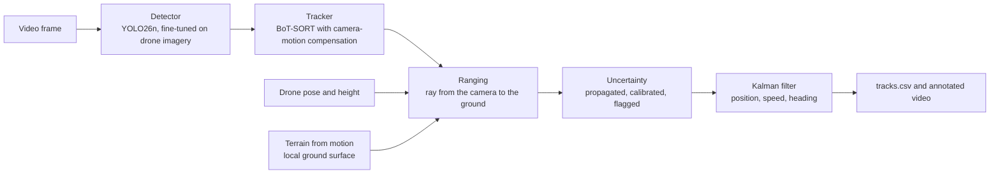

<div align="center">

# Aerial Track and Range

**Detect and track people and vehicles from a single drone camera, estimate how far away each one is with a calibrated error bar, and do it in real time on a laptop CPU.**


<sub>Held-out real flight (AU-AIR). Each vehicle carries its distance and one-standard-deviation error bar; green is reliable, amber is uncertain. Faint rings mark 10, 25, 50 and 100 m on the ground.</sub>

</div>

## Results at a glance

Every number on this page is generated from a results file in [`results/`](results/) by code in this repository. Each test split was run once, after all settings were frozen.

| | Result | Data |
|---|---|---|
| **Distance accuracy** | Median error **{{RESULT:headline.json#midair_test.terrain_median|.1%}}** (95 % interval {{RESULT:headline.json#midair_test.terrain_median_ci.0|.1%}} to {{RESULT:headline.json#midair_test.terrain_median_ci.1|.1%}}), against {{RESULT:headline.json#midair_test.flat_alt_median|.0%}} for flat ground with an altimeter | Mid-Air, {{RESULT:headline.json#midair_test.n_test_flights|d}} synthetic test flights with exact truth |
| **Calibrated error bars** | Nominal 90 % intervals contain the truth **{{RESULT:headline.json#midair_test.cov_cal_90|.0%}}** of the time ({{RESULT:headline.json#midair_test.cov_raw_90|.0%}} before calibration) | Mid-Air test |
| **Tracking** | Identity F1 **{{RESULT:headline.json#visdrone_test.vehicle_idf1|.3f}}** for vehicles, {{RESULT:headline.json#visdrone_test.person_idf1|.3f}} for people | VisDrone test-dev |
| **Real footage** | Parked vehicles' positions repeat to **{{RESULT:headline.json#auair.heldout_rel_all|.1%}}** of their distance | AU-AIR, held-out flights |
| **Speed** | **{{RESULT:headline.json#edge.fast_fps|.1f}} frames per second** sustained; {{RESULT:headline.json#edge.accurate_fps|.1f}} fps at the most accurate setting | {{RESULT:headline.json#edge.cpu|s}}, no GPU |

## How it works



A camera gives direction, not distance. Each tracked box's ground-contact point is turned into a ray and intersected with the ground: either a flat plane, or a local surface triangulated from image features tracked across frames using the drone's known motion ("terrain from motion"), which needs no height above the ground. Sensor noise is propagated to every range, the intervals are calibrated on separate flights (split conformal prediction), and a small, interpretable model flags estimates that are likely to be badly wrong.

## 1. Detect and track

<p align="center">
  
</p>

A YOLO26n detector fine-tuned on VisDrone, with the BoT-SORT tracker and camera-motion compensation, its thresholds tuned on validation data. Each colour and number is one identity kept across frames.

<p align="center">
  
</p>

**Left:** the off-the-shelf detector. **Right:** after fine-tuning and tuning. Mean identity F1 on validation rises from {{RESULT:headline.json#visdrone_val.b0_cmc_mean_idf1|.2f}} to {{RESULT:headline.json#visdrone_val.b2_960_tuned|.2f}}. On the test set, vehicles reach IDF1 {{RESULT:headline.json#visdrone_test.vehicle_idf1|.3f}} (MOTA {{RESULT:headline.json#visdrone_test.vehicle_mota|.3f}}) and people {{RESULT:headline.json#visdrone_test.person_idf1|.3f}}. Small people are the weak point: {{RESULT:headline.json#visdrone_test.person_recall_16_32|.0%}} are found at 16 to 32 pixels tall, against {{RESULT:headline.json#visdrone_test.person_recall_128|.0%}} above 128.

## 2. Range with honest uncertainty

<table>
<tr>
<td width="42%"></td>
<td></td>
</tr>
</table>

On synthetic flights, where the true distance of every pixel is known, each dot is a range estimate that stays on its spot on the ground: **circles** were within 10 % of the truth and **crosses** were not; **amber** means the reliability flag was raised. Terrain from motion keeps the median error at {{RESULT:headline.json#midair_test.terrain_median|.1%}}, and stays at or below {{RESULT:headline.json#midair_test.terrain_err_slope_30_45|.1%}} on slopes up to 45°; a flat-ground model, even given the true height, grows from {{RESULT:headline.json#midair_test.flat_err_slope_0_5|.0%}} on level ground to {{RESULT:headline.json#midair_test.flat_err_slope_45_90|.0%}} on slopes above 45°. After calibration, 90 % error bars hold {{RESULT:headline.json#midair_test.cov_cal_90|.0%}} of the time; the flag (AUROC {{RESULT:headline.json#midair_test.flag_auroc|.2f}}) catches {{RESULT:headline.json#midair_test.flag_recall|.0%}} of estimates more than 10 % off.

## 3. Real footage

<table>
<tr>
<td width="50%"></td>
<td width="50%"></td>
</tr>
</table>

AU-AIR records real flights with GPS and altitude but no camera calibration and no camera tilt, so both were measured from the footage itself: the focal length from GPS motion against image motion ({{RESULT:headline.json#auair.focal_px|.0f}} px), and the tilt from the motion of the ground ([camera model](docs/auair_camera_model.md)). On held-out flights, parked vehicles' estimated positions repeat to {{RESULT:headline.json#auair.heldout_rel_all|.1%}} of their distance ({{RESULT:headline.json#auair.heldout_segments|d}} vehicle segments). There is no ground truth here, so this is repeatability, not accuracy.

## 4. Real time on a laptop CPU

<p align="center">
  
</p>

Every setting was measured on the same laptop CPU ({{RESULT:headline.json#edge.cpu|s}}). ONNX export, a 640-pixel input, detection on every second frame (with the tracker predicting in between) and detection overlapped with tracking reach **{{RESULT:headline.json#edge.fast_fps|.1f}} frames per second** sustained, at mean IDF1 {{RESULT:headline.json#edge.fast_idf1|.3f}} against {{RESULT:headline.json#edge.accurate_idf1|.3f}} for the most accurate setting. Each frame's result still arrives {{RESULT:headline.json#edge.fast_latency_median_ms|.0f}} ms after capture (median), so 30 fps is met in throughput, not in per-frame delay.

## Quick start

```bash
python -m venv .venv
.venv/Scripts/python -m pip install -r requirements-lock.txt     # .venv/bin/python on Linux or macOS
.venv/Scripts/python -m pip install -e . --no-deps
.venv/Scripts/python -m pytest                                   # run the test suite
.venv/Scripts/aerialrange demo --out cache/demo                  # full pipeline on a synthetic flight, no datasets needed
```

The demo writes `tracks.csv`, `annotated.mp4` and `timing.json`, and checks every distance and speed against the synthetic truth. To run on a real flight (frames or a video, plus a flight-data CSV with position, height, heading and camera tilt per frame):

```bash
.venv/Scripts/aerialrange run --source <frames-or-video> --metadata <flight.csv> --out cache/run
```

## Documentation

| Document | What it covers |
|---|---|
| [Technical brief](docs/brief.md) | Two-page summary: problem, method, results, failure modes |
| [Limitations](docs/limitations.md) | Where it breaks, and by how much |
| [Questions a reviewer is likely to ask](docs/faq_for_reviewers.md) | Accuracy, latency, test hygiene, real sensors |
| [Model card](docs/model_card.md) and [data cards](docs/data_cards.md) | Detector, tracker, datasets and licences |
| [AU-AIR camera model](docs/auair_camera_model.md) | Focal length, tilt and altitude inferred from footage |
| [Decision log](docs/decisions.md) | Every design choice, with its reason and evidence |
| [Runbook](docs/runbook.md) | The commands that reproduce each result, in order |

## Repository layout

| Path | Contents |
|---|---|
| `src/aerialrange/geometry/` | Camera model, ranging, uncertainty propagation, triangulation, terrain fitting, Kalman filter (built test-first) |
| `src/aerialrange/track/`, `detect/` | Tracking, evaluation, tiling, saved-detection replay |
| `src/aerialrange/evaluate/` | Mid-Air and AU-AIR evaluations, conformal calibration, reliability flag, statistics |
| `src/aerialrange/pipeline/` | The end-to-end `aerialrange run` and `demo` |
| `src/aerialrange/edge/` | Latency benchmark harness |
| `scripts/` | One script per experiment |
| `configs/` | Every setting, each with its source |
| `results/` | Every number and figure quoted in the documents |

Code comments cite sections of the project specification (for example "Section 7.5"); the decision log records how each was applied.

## Scope

A perception and measurement project on public research datasets. People and vehicles are tracked as boxes only: no face analysis and no re-identification by appearance. Distances hold under stated assumptions (a known camera and pose, and flat ground or terrain from motion) and are not claimed beyond the tested conditions: low altitude ({{RESULT:headline.json#auair.alt_min_m|.0f}} to {{RESULT:headline.json#auair.alt_max_m|.0f}} m on real footage), short ranges, and one site for real footage.

## Datasets and credits

No datasets or model weights are stored in this repository; the short clips in `docs/media/` contain frames from the datasets below and are shared under their terms.

- **VisDrone2019**: P. Zhu, L. Wen, D. Du et al., "Detection and tracking meet drones challenge", *IEEE TPAMI*, 2021. Research use.
- **Mid-Air**: M. Fonder and M. Van Droogenbroeck, "Mid-Air: a multi-modal dataset for extremely low altitude drone flights", *CVPR Workshops*, 2019. CC BY-NC-SA 4.0.
- **AU-AIR**: I. Bozcan and E. Kayacan, "AU-AIR: a multi-modal unmanned aerial vehicle dataset for low altitude traffic surveillance", *ICRA*, 2020. CC BY 4.0.
- Detector and trackers: [Ultralytics](https://github.com/ultralytics/ultralytics) (AGPL-3.0).

## Licence

[GNU Affero General Public License v3.0 only](LICENSE), matching the detector library.
